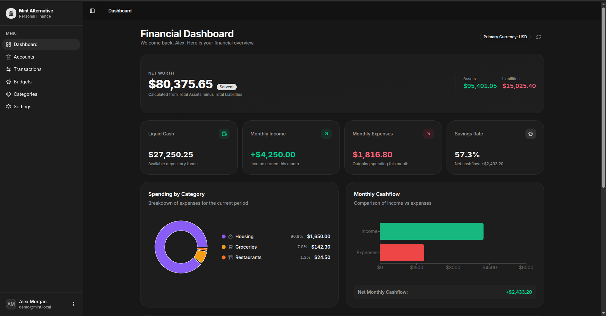
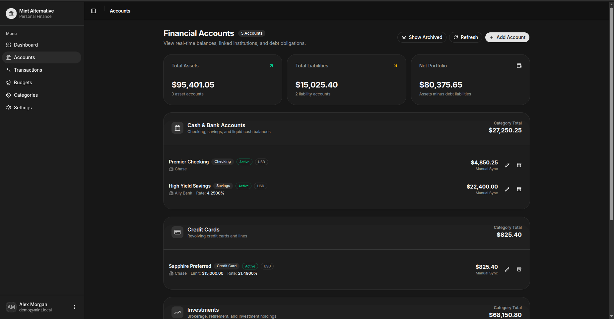

# Mint Frontend

A modern, open-source personal finance dashboard built with React and TypeScript.

Mint Frontend is the web interface for **Mint Alternative**, a personal finance platform inspired by the original Mint application. The goal is to make managing accounts, tracking spending, creating budgets, and understanding personal finances simple and accessible.

The application is designed to be responsive, mobile-friendly, and eventually installable as a Progressive Web App (PWA).

> **Project Status:** Early development. Features and integrations are being implemented incrementally.



## Tech Stack

| Technology | Purpose |
|---|---|
| React | Frontend framework |
| TypeScript | Type-safe development |
| Vite | Development server and build tooling |
| Tailwind CSS | Styling and responsive design |
| shadcn/ui | Reusable UI components |
| Recharts | Financial charts and visualizations |
| TanStack Query | API data fetching and caching |
| React Router | Client-side routing |
| vite-plugin-pwa | Planned PWA support |

## Current and Planned Features

### Dashboard

- Total assets, liabilities, and net worth
- Monthly income and expenses
- Monthly spending breakdown by category
- Recent transactions and financial activity

### Accounts

- Checking and savings accounts
- Credit cards and loans
- Investment accounts
- Balances grouped by account type
- Manual account creation, editing, archiving, and restoration
- Account balance history (planned)



### Transactions

- Searchable and filterable transaction history
- Transaction categorization
- Manual transaction entry
- Transaction editing and deletion
- Merchant rules and recurring transaction identification (planned)

### Categories

- Built-in and custom income, expense, and transfer categories
- Custom category creation, editing, and deletion
- Parent categories with subcategories

### Budgets (planned)

- Monthly and category-based budgets
- Budget utilization and remaining balances
- Spending progress indicators
- Historical budget comparisons

### Financial Insights (planned)

- Income and expense trends
- Net worth tracking
- Spending breakdowns
- Savings goals and debt repayment progress

### Mobile Experience

The frontend will prioritize responsive layouts and mobile usability.

Planned PWA capabilities include home-screen installation, app-like navigation, and appropriate offline support.

## Architecture

The frontend communicates with a separate Go backend through a REST API.

```text
                   Mint Frontend
                React + TypeScript
                        |
               TanStack Query
                        |
                     REST API
                        |
                    Go Backend
                        |
                    PostgreSQL
                        |
              Financial Data Layer
                        |
              Banking Integrations
```

Financial calculations, account ownership, authentication, and sensitive banking operations are handled by the backend rather than the browser.

## Project Structure

The frontend is intended to use a feature-oriented structure as development progresses.

```text
src/
├── components/
│   ├── ui/
│   ├── layout/
│   └── shared/
├── features/
│   ├── dashboard/
│   ├── accounts/
│   ├── transactions/
│   ├── budgets/
│   └── insights/
├── hooks/
├── lib/
│   ├── api/
│   └── utils/
├── routes/
├── types/
└── main.tsx
```

The actual directory structure may evolve as features are implemented.

## Getting Started

### Prerequisites

- Node.js (a version compatible with the installed Vite release)
- npm
- Git

### Clone the Repository

```bash
git clone git@github.com:rpmoulton/mint-frontend.git
cd mint-frontend
```

### Install Dependencies

```bash
npm install
```

### Start Development Server

```bash
npm run dev
```

Vite will display the local development URL in the terminal.

### Run Tests

```bash
npm test
```

### Production Build

```bash
npm run build
```

## Backend Integration

Mint Frontend is designed to connect to the separate Mint Alternative Go API.

The frontend uses a centralized API client and TanStack Query for server-state management.

Available API resources include:

| Resource | Endpoint |
|---|---|
| Authentication | `POST /api/v1/auth/login`, `POST /api/v1/auth/refresh`, `GET /api/v1/auth/me`, `POST /api/v1/auth/logout` |
| Financial Summary | `GET /api/v1/dashboard/summary` |
| Accounts | `GET /api/v1/accounts` |
| Transactions | `GET /api/v1/transactions` |
| Budgets | `GET /api/v1/budgets` |
| Categories | `GET /api/v1/categories` |

## Development Roadmap

### Phase 1 — Foundation

- [x] Configure application routing
- [x] Establish responsive application layout
- [x] Configure shared UI components
- [x] Implement API client
- [x] Add loading, error, and empty states

### Phase 2 — Dashboard

- [x] Financial overview cards
- [x] Income and expense charts
- [x] Spending category visualization
- [x] Recent transactions

### Phase 3 — Financial Management

- [x] Account balance summaries on the Accounts page
- [x] Account management screens
- [x] Transaction list, search, and filters
- [x] Transaction editing and categorization
- [x] Manual transaction entry and deletion
- [x] Custom category management
- [ ] Account balance history
- [ ] Monthly budget management
- [ ] Financial insights

### Phase 4 — Mobile and PWA

- [x] Mobile-first navigation
- [x] Responsive financial charts
- [ ] Installable PWA
- [ ] Offline handling and synchronization strategy
- [ ] Mobile usability improvements

### Phase 5 — Production Readiness

- [x] Authentication integration
- [ ] Accessibility review
- [x] Unit and component testing
- [x] End-to-end testing
- [ ] Performance optimization
- [ ] Production deployment configuration

## Security and Privacy

Mint Frontend is intended to handle sensitive financial information responsibly.

The application will be designed to:

- Communicate with the backend over HTTPS in production
- Avoid storing banking credentials in browser storage
- Use secure authentication and session handling
- Prevent sensitive financial data from entering analytics or error-reporting payloads
- Support appropriate authorization and account isolation through the backend
- Avoid caching sensitive financial responses in offline storage without explicit safeguards

The application is not currently security-audited and should not be used with real financial credentials until production security controls have been implemented and tested.

## Contributing

Contributions and feedback are welcome.

Contribution guidelines will be added as the project matures.

## License

This project is licensed under the [MIT License](LICENSE).

## Acknowledgments

Inspired by the original Mint personal finance application.

Built using React and the open-source frontend ecosystem, including shadcn/ui.

This project is independent and is not affiliated with or endorsed by Intuit or Mint.

---

**Mint Frontend — A clearer picture of your finances.**
